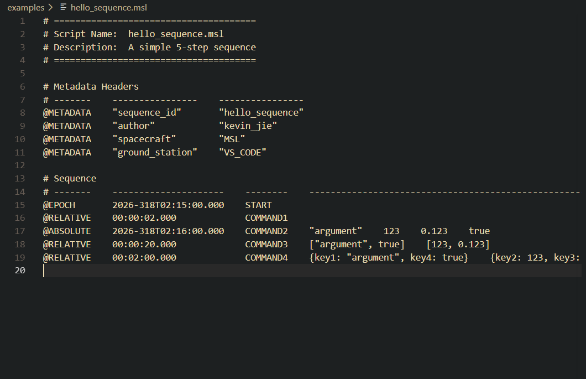
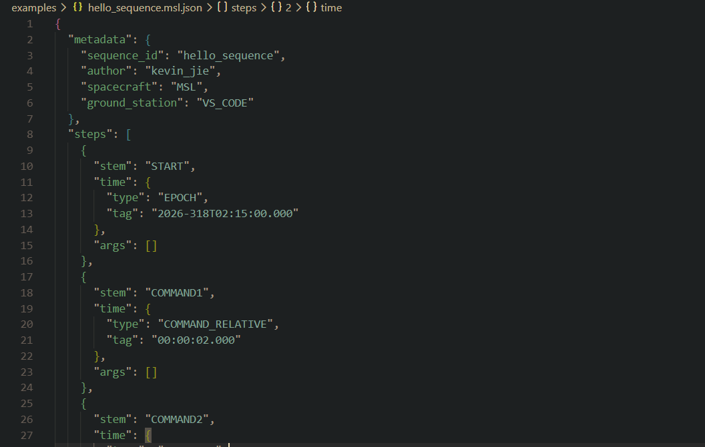

# Mission Sequencing Domain-Specific Language (DSL)


A domain-specific language for spaceflight mission sequencing.

| Example Script | Example Output |
| --- | --- |
|  |  |


<br>


## Table of Contents

1. [Rationale](#rationale)
2. [Features](#features)
3. [Prerequisites](#prerequisites)
4. [Installation](#installation)
5. [Build](#build)
6. [Usage and Example](#usage-and-example)
7. [References and Sources](#references-and-sources)


<br>


## Rationale

Mission sequencing in spaceflight autonomy must not pose risks. Actions should be deterministic and highly controlled in order to ensure success, as failure in spaceflight is often nothing short of expensive. Consequently, this project aims to design a domain-specific language for mission sequencing written in C. The language aims to only express what a sequence calls for, stripping away any volatile, risk-posing architecture.


<br>


## Features

* `.msl` source code files
* `.msl.json` output files
* Timed steps
* Metadata
* Typed arguments (strings, numbers, booleans, arrays, and objects)
* Error reporting
* Token dump CLI
* No dependencies

See [ARCHITECTURE.md](ARCHITECTURE.md) for design choices and language architecture.


<br>


## Prerequisites

* [Git](https://git-scm.com/)
* C11 compiler
    * Must accept GCC-style flags
    * Commands below use [GCC](https://gcc.gnu.org/)


<br>


## Installation

```
git clone https://github.com/kevinn-jie/mission-sequencing-dsl.git
cd mission-sequencing-dsl
```


<br>


## Build

Run the build command from the project root.

```bash
gcc -std=c11 -O2 -flto -Wall -Wextra -Wpedantic -Wshadow -Wconversion -Wformat-security -Wnull-dereference -Werror -pedantic-errors -fstack-protector-strong -fdiagnostics-color=always ./src/main.c ./src/source.c ./src/scanner.c ./src/parser.c ./src/emitter.c -o ./build/msl.exe
```

Tested with GCC 16.2.0. This build command treats warnings as errors. Other compiler versions may report new warnings as errors.


<br>


## Usage and Example

Run commands from the project root.

```
./build/msl.exe <input.msl> <option>
```

| Option | Description |
| --- | --- |
| `--help` | Show the help information |
| `--tokens` | Print the tokens scanned from `<input.msl>` |
| `-o <output.msl.json>` | Compile `<input.msl>` to JSON at `<output.msl.json>` |

Only one option is allowed per call.


<br>


### Example

Given `example.msl`:

```
@METADATA    "sequence_id"    "hello_sequence"
@METADATA    "author"         "kevin_jie"

@EPOCH       2026-318T02:15:00.000    START
@RELATIVE    00:00:02.000             COMMAND1    "argument"    123    true
```

Running `./build/msl.exe example.msl -o example.msl.json` writes:

```json
{
  "metadata": {
    "sequence_id": "hello_sequence",
    "author": "kevin_jie"
  },
  "steps": [
    {
      "stem": "START",
      "time": {
        "type": "EPOCH",
        "tag": "2026-318T02:15:00.000"
      },
      "args": []
    },
    {
      "stem": "COMMAND1",
      "time": {
        "type": "COMMAND_RELATIVE",
        "tag": "00:00:02.000"
      },
      "args": [
        "argument",
        123,
        true
      ]
    }
  ]
}
```

A longer example is in [examples/hello_sequence.msl](examples/hello_sequence.msl), which outputs [examples/hello_sequence.msl.json](examples/hello_sequence.msl.json).


<br>


## References and Sources

* [seq-json-schema](https://github.com/NASA-AMMOS/seq-json-schema)
* [DevDocs - C documentation](https://devdocs.io/c/)
* [Crafting Interpreters](https://craftinginterpreters.com/contents.html)
    * [Scanning](https://craftinginterpreters.com/scanning.html)
    * [Parsing](https://craftinginterpreters.com/parsing-expressions.html)
* [Managing releases in a repository](https://docs.github.com/en/repositories/releasing-projects-on-github/managing-releases-in-a-repository)
* [MDN Web Docs](https://developer.mozilla.org/en-US/docs/Web/HTML)
